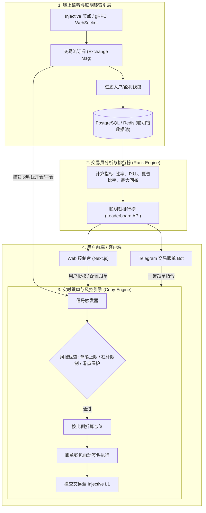

# Injective 链上聪明钱「一键跟单系统」设计蓝图

## 1. 为什么在 Injective 上做跟单是天然优势？

1. **链上极速确认（<1 秒）**：以太坊跟单容易被抢跑（MEV）或因为延迟导致成交价脱节；而 Injective 亚秒级出块，跟单延迟极低，滑点可控。
2. **底层共享订单薄**：所有交易（Helix、各前端）最终都通过链底层的 Exchange Module 进行撮合，所有大户的挂单、撤单、持仓在链上**百分之百公开透明**。
3. **天然变现（40% 手续费分成）**：每一笔跟单发起的链上交易，你的系统都能直接拿到 Injective 协议底层 **40% 的手续费分成**，无需向用户强制收费即可躺赚。

---

## 2. 系统核心架构图

---

## 3. 四大核心模块详解

### 模块一：链上聪明钱筛选器（Smart Money Scanner）
* **监控目标**：通过 Injective gRPC API（`@injectivelabs/sdk-ts`）实时订阅永续合约和现货模块的消息（`MsgCreateDerivativeMarketOrder` 等）。
* **筛选算法**：
  * 近 30 天胜率 $\ge 65\%$
  * 累计盈亏（PnL）正向
  * 最大回撤（Max Drawdown）$< 25\%$
  * 自动为这些优质地址打上“交易员”标签并收录进排行榜。

### 模块二：毫秒级跟单引擎（Execution Engine）
* **触发机制**：当目标地址向链上发送开仓指令时，WebSocket 捕获到事件并立即广播给订阅该地址的跟单者。
* **仓位折算策略**：
  * **固定金额模式**：大户买 10 万刀，用户固定只跟 100 刀。
  * **按比例复制模式**：按照用户可用保证金的固定百分比（如 5%）跟投。
* **安全风控拦截（至关重要）**：
  * 最大滑点限制（避免被大户当成退出流动性恶意收割）。
  * 强行止损设置（如跟随单亏损达 15% 自动平仓，不盲目等大户止损）。

### 模块三：用户资金托管与授权方案
用户最关心的就是“资金安全”，必须采用安全机制：
* **方案 A：子账户（Subaccount）授权**
  * Injective 原生支持多子账户（Subaccounts）。用户可以在主钱包下开一个专用于跟单的子账户，转入有限的本金，授权 API 密钥只拥有“交易权限”，**无提币权限**。
* **方案 B：智能合约保险库（Vault）**
  * 用户将资金存入非托管智能合约，合约仅允许在执行跟单时调用交易接口，任何人都无法提取资金。

### 模块四：盈利变现模型（你如何赚钱？）
1. **Injective 协议 40% 手续费分成**：用户跟随产生的每一笔交易量，都在源源不断为你积累协议分润。
2. **跟单利润提成（Profit Sharing）**：跟单盈利部分抽取 10%~20%（其中 10% 归带单大佬，5%~10% 归平台）。

---

## 4. 推荐落地规划（分步走）

| 阶段 | 周期 | 核心目标 | 交付物 |
| :--- | :--- | :--- | :--- |
| **Phase 1: 最小可用原型 (MVP)** | 1~2 周 | 跑通单钱包监听与自动复制交易 | Node.js 监听脚本 + 自动执行跟单 |
| **Phase 2: Telegram 跟单 Bot** | 1 周 | 降低用户门槛，支持一键在 TG 绑定并跟单 | TG Bot 交互前端 + 仓位变动推送 |
| **Phase 3: 聪明钱 Web 排行榜** | 2 周 | 前端展示真实盈亏大户，吸引外部流量 | Next.js 界面 + 钱包连接 (Keplr/MetaMask) |
| **Phase 4: 申请 Injective 官方 Grant** | 1 周 | 向官方提交 Demo 申请生态资助与流量推荐 | 获得官方推特推广与上架 Hub |
